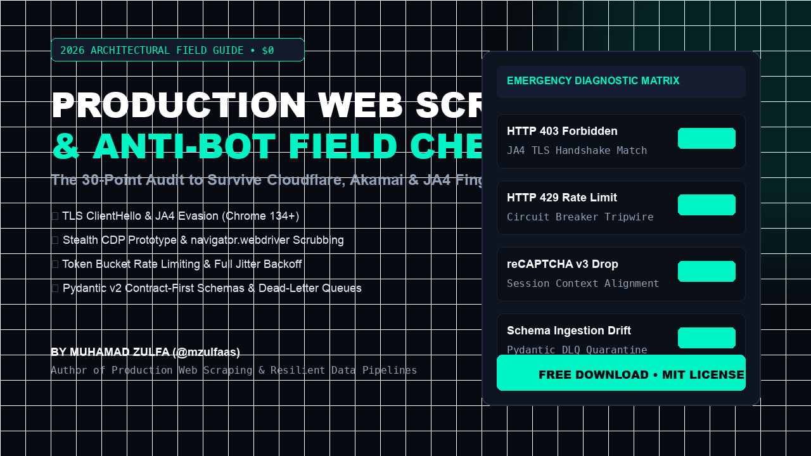

# 🛡️ Python Anti-Bot Web Scraper & Client Hints Engine (Lite)



[](https://www.python.org/downloads/)
[](https://opensource.org/licenses/MIT)
[](https://mzulfaas.gumroad.com/l/vswgx)
[](https://mzulfaas.gumroad.com/l/xlxvnb)
[](https://mzulfaas.gumroad.com/l/xlxvnb)

A lightweight, zero-dependency Python boilerplate designed to navigate modern web bot protections (Cloudflare, Akamai, Datadome) using synchronized `Sec-CH-UA` Client Hints, randomized browser fingerprints, and jittered exponential retry backoff.

Authored by **Muhamad Zulfa** ([@mzulfaas](https://x.com/mz0029)), author of *"Production Web Scraping & Resilient Data Pipelines"* on Amazon Kindle.

---

### 📚 The Complete Engineering Ecosystem

1. 🧲 **[Free 30-Point Anti-Bot Field Checklist ($0 Download)](https://mzulfaas.gumroad.com/l/vswgx)**:  
   Download the complete architectural audit covering TLS JA4 handshake alignment, CDP sanitization, residential circuit breakers, and Pydantic v2 dead-letter queues.
2. ⚡ **[Production Python Scraper Kit ($29 on Gumroad)](https://mzulfaas.gumroad.com/l/xlxvnb)**:  
   The battle-tested, plug-and-play Python Asyncio crawler template with built-in JA4 evasion, proxy pool rotation, schema validation, and CSV/SQLite persistence.
3. 📖 **Production Web Scraping & Resilient Data Pipelines (Amazon Kindle $9.99)**:  
   The definitive 25,836-word architectural handbook covering distributed worker queues (RabbitMQ/Celery), Kubernetes runner nodes, and enterprise legal compliance.

---

### 🚨 Why 90% of Python Scrapers Get Blocked in 2026

Most scrapers fail today not because their IP is flagged, but because their **HTTP headers and cryptographic handshakes are inconsistent**:
1. **Missing Sec-CH-UA**: Modern browsers send Structured Client Hints (`Sec-CH-UA`, `Sec-CH-UA-Mobile`, `Sec-CH-UA-Platform`). A scraper sending only a `User-Agent` string looks immediately robotic.
2. **Platform & Engine Mismatches**: Sending a Chrome on macOS `User-Agent` while omitting `Sec-CH-UA-Platform: "macOS"` triggers instant behavioral detection.
3. **Rigid Retry Intervals**: Fixed retry loops (`sleep(2)`) are trivially identified as machine automation.
4. **TLS JA3/JA4 Fingerprints**: Standard Python `requests` or `urllib3` advertise OpenSSL ciphers that are blacklisted at the network perimeter before HTTP even reaches the server.

This repository demonstrates the lightweight, zero-dependency approach to aligning your browser fingerprint with real user sessions.

---

### 📦 Features (Lite vs. Production)

| Feature | Lite (Open Source) | Production Kit (Gumroad $29) |
| :--- | :---: | :---: |
| **Zero External Dependencies** | ✅ | ✅ |
| **Synchronized Sec-CH-UA Client Hints** | ✅ | ✅ |
| **Jittered Exponential Backoff** | ✅ | ✅ |
| **Randomized Realistic Browser Fingerprints** | Basic (3 UAs) | Advanced (25+ Mapped Profiles) |
| **SQLite Persistence & Automatic Migrations** | ❌ | ✅ |
| **Automatic CSV Exporter & Schema Validation** | ❌ | ✅ |
| **Proxy & Session Pool Architecture** | ❌ | ✅ |
| **Async / Multi-Threaded Batch Scraper** | ❌ | ✅ |
| **Priority Support & Updates** | ❌ | ✅ |

👉 **[Unlock the Full Production Scraper Kit on Gumroad ($29)](https://mzulfaas.gumroad.com/l/xlxvnb)**

---

### 🚀 Quickstart

Run with 0 external packages (Standard Library only):

```bash
git clone https://github.com/mzulfaas/python-scraper-anti-bot-boilerplate.git
cd python-scraper-anti-bot-boilerplate
python3 lite_scraper.py
```

### 💻 Code Example

```python
from lite_scraper import AntiBotScraper

scraper = AntiBotScraper()
html = scraper.fetch("https://httpbin.org/headers")
print(html)
```

---

### 📄 License

MIT © [Muhamad Zulfa](https://github.com/mzulfaas). Built for developers, data engineers, and automation builders.
